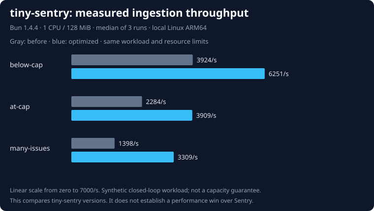

# Bun 1.4.4 ingestion optimizations

This measures tiny-sentry before and after incremental retention and bounded write batching. **It does not establish that tiny-sentry is faster than Sentry.** The [historical Sentry comparison](README.md) uses different resource allocations, Bun 1.4.2, and host bind mounts. Sentry has not been rerun against this implementation, so comparing these rates with that report would not be a matched experiment.

## Results

Both versions ran on Bun 1.4.4 with **1 CPU, 128 MiB RAM, and no swap**. Three fresh runs per version alternated execution order. Values are **median (minimum–maximum)** of the three per-run observations, including the per-run latency percentiles; these are not pooled percentiles or confidence intervals.



<!-- performance-table -->
| Metric | Before | Optimized |
| --- | ---: | ---: |
| below-cap: HTTP acknowledgements/s | 3923.77 (3853.31–4075.41) | 6250.76 (6140.20–6932.39) |
| below-cap: HTTP p95, ms | 9.87 (9.03–10.39) | 2.38 (2.14–2.60) |
| at-cap: HTTP acknowledgements/s | 2283.73 (2189.91–2492.01) | 3909.30 (3750.68–3999.96) |
| at-cap: HTTP p95, ms | 14.54 (13.31–14.90) | 12.04 (11.96–13.08) |
| many-issues: HTTP acknowledgements/s | 1397.84 (1283.10–1424.32) | 3309.32 (3278.40–3348.93) |
| many-issues: HTTP p95, ms | 18.77 (18.13–20.00) | 13.93 (13.77–13.94) |
| Paired POST/GET time-to-query p95, ms | 20.09 (16.86–22.29) | 15.22 (15.18–17.77) |
| Paced personal workload HTTP p95, ms | 7.28 (5.44–7.40) | 4.00 (3.77–8.86) |
| Final process RSS, MiB | 58.49 (58.00–58.96) | 61.31 (60.75–61.61) |
| Process RSS high-water mark, MiB | 70.15 (69.57–70.85) | 77.00 (72.54–77.30) |
<!-- /performance-table -->

Every measured request succeeded. Each run accepted 16,220 events including warm-up and prefill; the runner individually retrieved all 5,220 measured/visibility/personal event IDs and checked that retention ended with exactly 10,000 events in 2,040 issues. Across six runs this is 97,320 accepted requests and 31,320 individually verified event IDs. Warm-up/prefill IDs are checked through retained counts, rather than individually retrieved.

Batching trades some peak process memory for throughput. Both versions completed inside the same 128 MiB limit, but that does not establish a safe limit for every configuration or payload. RSS high-water marks come from the kernel; Docker working-set snapshots in the raw file measure something different. These observations do not establish Railway's billable memory or long-term leak freedom. The [original full memory suite](README.md#measured-tiny-sentry-memory-under-load) remains a separate historical experiment.

## What changed

- SQLite triggers maintain the global retained-event count inside the same transaction as each insert/delete. This avoids recounting or walking the retained event set on every request and remains consistent after rollback, restart, or writes through another connection.
- Cap enforcement selects only the excess oldest events through the existing age index. Deletion checks only the affected issue for orphan cleanup. Age expiration and exact global caps remain enforced after each request inside the transaction.
- Concurrent requests waiting in the same event-loop turn can share a commit. The queue flushes at 32 requests or a pending payload budget of twice `MAX_REQUEST_BYTES`; a larger individual request flushes immediately. There is no fixed batching timer. Redundant nested transactions were removed.
- HTTP success waits for the outer commit. A storage failure rolls back and rejects the whole shared commit. Privacy scrubbing, validation, project isolation, deduplication, and SQLite's WAL / `synchronous=NORMAL` configuration remain in place. This is not a claim of power-loss durability.

Existing databases migrate transactionally to schema 2. A pre-upgrade backup is needed to return to a schema-1 image. Contract tests cover populated-schema migration, cross-connection counts, retention ordering, duplicate deliveries, committed visibility through an independent connection, and recovery after a failed shared write.

The exploratory [retention-only runs](experiments/retention.json) and [first batching trial](experiments/batching.json) informed the implementation. They are excluded from the final table. The first trial still had nested transactions; the final candidate removes them. Preliminary runs lack some stages added to the final runner and are not interchangeable with it.

## Workload and limitations

Each run starts one fresh container and Linux Docker named volume. Only one benchmark service runs at a time. Two unrelated idle development containers remain running; they are excluded from memory snapshots. The load generator runs on macOS outside the capped container. Host and engine details, immutable image IDs, status counts, snapshots, and individual run summaries are in [performance.json](performance.json).

The common generator sends uncompressed 2 KiB Sentry exception envelopes with explicit fingerprints and eight concurrent requests, except for the paced personal stage. Work proceeds in this order on one database per run:

1. Warm up with 1,000 events in ten groups.
2. Measure 2,000 events in ten new groups below the cap; individually retrieve every acknowledged ID.
3. Prefill with 7,000 events to reach 10,000 retained rows.
4. Measure 2,000 events in ten new groups while replacing old rows; individually retrieve every acknowledged ID.
5. Run a separate 200-event paired POST/GET workload with eight workers. Each worker waits for a successful matching API lookup before sending another event.
6. Send 20 events at two per second with one worker; individually retrieve every acknowledged ID.
7. Prefill 1,000 distinct groups, then measure another 1,000 events in 1,000 new groups; individually retrieve every acknowledged ID. Check final retention.

Time-to-query starts immediately before POST and ends after consuming a successful matching GET response. It includes acknowledgement, API work, transport, and any 5 ms polling intervals. It is an upper bound on visibility, not an internal storage timestamp. The paired workload changes offered traffic; its throughput is deliberately excluded. It is independent of the ingestion-only stages and cannot be compared directly with their acknowledgement latency.

The personal stage has only 20 latency samples per run. Shared-host scheduling, CPU quota throttling, JIT warm-up, filesystem caching, Docker networking, simple payloads, and closed-loop load all affect results. High-cardinality traffic also emits new-issue logs on both versions. No TLS, SDK overhead, compression storms, fixed-rate saturation curve, webhook load, symbolication, or source maps are measured. Rate limits are raised for this experiment; the default remains 120 requests per project per minute. Snapshots do not measure peak cgroup usage. No Railway service was provisioned.

## Reproduce

Use an idle Docker host with Bun 1.4.4. Run from the repository root. The runner creates and removes only its own containers and named volumes; it does not prune Docker state. Raw output is overwritten, so choose `BENCH_OUTPUT` when preserving an existing run.

```sh
bun install --frozen-lockfile
git archive a675383d0d791b225886b01ed79d84aeb3ae3eca | docker build -t tiny-sentry:perf-before -
docker build -t tiny-sentry:perf-after .
BENCH_REPEATS=3 bun run benchmark:performance tiny-sentry:perf-before tiny-sentry:perf-after
bun run benchmark:performance:report
```

The report command regenerates the table above and its SVG from `benchmarks/performance.json`. The baseline is commit `a675383d0d791b225886b01ed79d84aeb3ae3eca`. The optimized production sources are identified by their SHA-256 hashes in the raw file. Reproduction on a different machine is expected to produce different absolute timings.

To claim a win over Sentry, rerun both systems on a dedicated Linux host with matched hardware budgets, the same supported error workload, and both acknowledgement and paired visibility measurements. Keep all Sentry errors-only services running and include failures, drain behavior, CPU, and full-stack memory. This report makes no Sentry SaaS performance claim.
