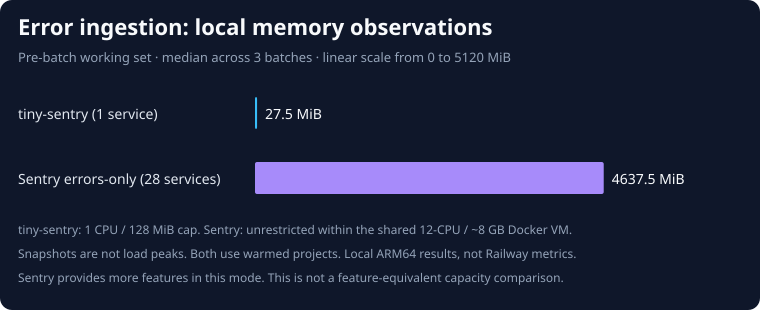
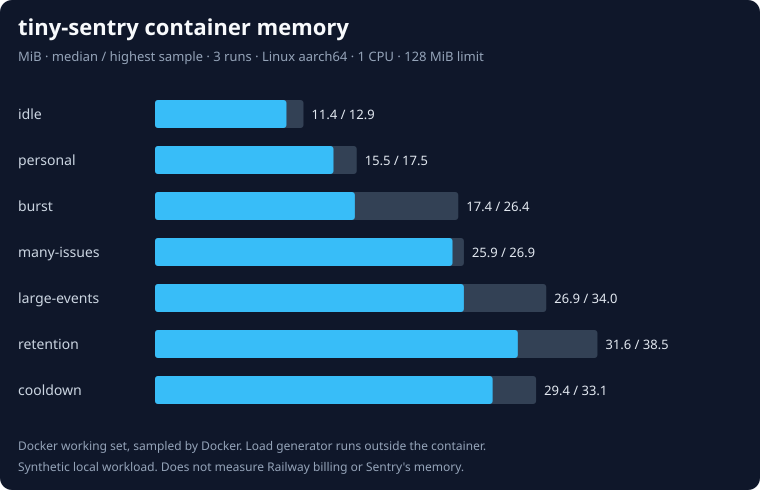

# Error-ingestion benchmark and memory analysis

This compares the narrow job tiny-sentry implements: receiving JSON exception envelopes, grouping them with explicit fingerprints, retaining events, and retrieving them through an API. The Sentry baseline is **self-hosted Sentry 26.10.1 in its official errors-only mode**, not the full-feature deployment or Sentry SaaS.

## Measured comparison, 2026-11-03

Both systems accepted and returned every event in three measured batches of 2,000 uncompressed 2 KiB errors, with eight concurrent requests and ten explicit fingerprints per batch. No failed requests or missing events occurred. The error payload generator and HTTP client are the same. The table gives the **median (minimum–maximum)** across the three batches; memory values sum all containers in that system.

| Metric | tiny-sentry 0.1.0 | Sentry 26.10.1 errors-only |
| --- | ---: | ---: |
| Accepted and retrieved events | 6,000 / 6,000 | 6,000 / 6,000 |
| Running service containers | 1 | 28 |
| Available CPU / memory limit | 1 CPU / 128 MiB | Shared 12-CPU / ~8 GB Docker VM |
| Pre-batch working set, MiB | 27.50 (27.11–29.56) | 4,637.53 (4,561.66–4,795.34) |
| After acknowledgement working set, MiB | 29.22 (27.38–32.36) | 4,576.68 (4,560.00–4,789.68) |
| After verification working set, MiB | 29.69 (28.35–33.10) | 4,583.69 (4,156.96–4,650.31) |
| HTTP acknowledgements/s | 2,866.56 (2,737.27–3,058.63) | 9,126.63 (7,635.04–11,389.27) |
| HTTP acknowledgement p95, ms | 7.83 (7.32–8.34) | 1.47 (1.26–2.32) |
| Post-load verification scan, seconds | 0.13 (0.10–0.13) | 72.43 (69.20–74.21) |



**Sentry acknowledged faster in this experiment.** Its Relay queues work for asynchronous processing, and it had access to more CPU. tiny-sentry commits its SQLite transaction before acknowledging. These are acknowledgement measurements, not equivalent processing or durability guarantees. The post-load scan's ~72 seconds for Sentry reflects the time to perform 2,000 rich event-detail API lookups; it does **not** mean Sentry took 72 seconds to ingest those errors. This experiment did not measure a comparable per-event time-to-query distribution.

**tiny-sentry had a much smaller observed memory footprint for its smaller scope.** Sentry's memory is measured across the actual errors-only stack, including its databases, brokers, workers, proxy, and symbolicator. It still offers substantially more functionality. Pre-batch memory is warmed, populated state; these snapshots are neither fresh-start idle memory nor load peaks. No vendor minimum-RAM requirement is substituted for a measurement.

The host was an Apple M2 Max running OrbStack Linux ARM64, with 12 logical CPUs and 8,392,343,552 bytes assigned to Docker. Two unrelated idle Redis/TimescaleDB containers remained running and are excluded from both memory totals. This shared local VM, its bind mounts, and the different resource limits prevent a controlled capacity or Railway billing comparison. Upstream recommends a dedicated Linux VM for Sentry installations; use one when reproducing. No Railway service was provisioned for this experiment.

Each system used one project across the measured batches, with a new fingerprint namespace per batch and no state reset. Both had a 2,000-event pre-measurement batch; Sentry's initial verification scan was interrupted when a stopped symbolicator was noticed, so its warm-up differs. Symbolicator was restarted and healthy before the measured batches. All 28 Sentry services were running at the beginning and end of measurement. The interrupted trial is excluded. Sentry's defaults were otherwise kept, with errors-only mode and 14-day retention. Its stack was stopped and removed before tiny-sentry ran. The tiny-sentry comparison retained the default 10,000-event/256 MiB caps and raised its request-rate limit.

Raw evidence: [tiny-sentry observations](tiny-comparison.json), [Sentry observations](sentry-comparison.json), [tiny-sentry configuration](tiny-environment.json), and [Sentry configuration and service inventory](sentry-environment.json). Service code was the initial `ee0841f966bad6f3cad4704de1e4efceda69cfec` version. Benchmark tooling adds no runtime dependency or production instrumentation.

## Measured tiny-sentry memory under load

Three fresh container/database runs each accepted **16,060 events**, produced the expected fingerprint groups, and ended with exactly **10,000 retained events in 10 issues**. That is 48,180 accepted events across the suite, with no ingestion failures. All runs completed within a **1 CPU / 128 MiB / no-swap** container limit. [Raw samples, process snapshots, and retained counts](results.json) are committed.

| Phase | Median working set (MiB) | Highest sampled working set (MiB) | Accepted/s, median | HTTP p95 (ms), median |
| --- | ---: | ---: | ---: | ---: |
| idle | 11.43 | 12.91 | — | — |
| personal | 15.52 | 17.54 | 2.03 | 8.57 |
| burst | 17.38 | 26.37 | 2923.61 | 7.62 |
| many-issues | 25.87 | 26.86 | 2332.11 | 8.48 |
| large-events | 26.86 | 34.02 | 1095.11 | 18.51 |
| retention | 31.55 | 38.47 | 1694.15 | 31.38 |
| cooldown | 29.36 | 33.14 | — | — |

Working-set medians above are the median of each run's phase median. Peaks are the highest recorded sample across all three runs. HTTP p95 and throughput are medians of the three per-run results, not pooled distributions. The `personal` rate is paced, and the burst stages are unpaced; their throughput should not be compared as competing capacity results. Some fast stages have only one or two memory samples per run.



| Process measurement | Median (minimum–maximum), MiB |
| --- | ---: |
| RSS at idle snapshot | 43.33 (43.32–43.72) |
| RSS after the 15-second cooldown | 58.24 (56.62–58.77) |
| Kernel RSS high-water mark after all workloads | 73.83 (72.98–74.73) |

The highest Docker working-set sample was **38.47 MiB**, while the highest kernel process RSS was **74.73 MiB**. These metrics answer different questions. RSS includes resident file-backed mappings such as Bun's executable/library pages. Docker subtracts inactive file cache, and shared/reused file pages may be charged outside a particular container's cgroup. **Do not treat an 11 MiB Docker working set as the application's full resident memory requirement.** Neither number establishes Railway's billable memory.

The `/proc/1/smaps_rollup` snapshots show about **33.96 MiB file-backed PSS and 9.19 MiB anonymous PSS** at idle, versus **38.48 MiB file-backed and 19.87 MiB anonymous** after load (medians). This supports a runtime/code-mapping baseline plus additional allocations during ingestion. It does not separate JavaScript heap, Bun's native allocations, and SQLite caches. No heap profiler or forced garbage collection was used.

RSS remained above its idle level after 15 seconds, and below its recorded high-water mark. This short experiment does not establish long-term leak freedom. It also does not exercise maximum-size concurrent envelopes, a full 256 MiB database, compressed request storms, backups during load, webhooks, or all possible JSON shapes. Leave memory headroom and check actual Railway metrics before setting a limit.

The final main database was about **99.3 MiB**, plus approximately **4 MiB of WAL** and a small SHM file, despite retaining only 10,000 2 KiB input events. Earlier large events grew the file; pruning frees pages for reuse and does not shrink it. Event count and the database page cap primarily bound storage, not RAM. The synchronous ingestion path also runs pruning per envelope, so these results do not imply that throughput stays constant as retained data or concurrency changes.

## Reproduce tiny-sentry's memory measurements

Requires Bun 1.4.4+, Docker, and enough temporary disk space for three databases. No benchmark packages are installed. The published measurements above used Bun 1.4.2; they have not been rerun on 1.4.4. Use the recorded source commit and runtime for those historical results. Run from the repository root to measure the current version:

```sh
bun install --frozen-lockfile
docker build -t tiny-sentry:benchmark .
bun run benchmark
bun run benchmark:report
```

The runner creates a fresh database/container for each of three repetitions, and removes its containers and temporary data afterward. It writes `benchmarks/results.json`. Change `BENCH_REPEATS`, `BENCH_IMAGE`, or `BENCH_OUTPUT` when needed. Run the report with `bun run benchmark:report path/to/results.json` for another result file. Avoid other builds, load tests, and image downloads during measurements.

Each container has one CPU, a 128 MiB memory limit, and no swap. The client runs outside the container. Retention stays at 14 days / 10,000 events, the SQLite page cap stays at 256 MiB, and the webhook is disabled. **The ingestion rate limit is raised to 1,000,000/minute for this experiment**. The production default is 120 requests per project per minute; reported burst throughput does not describe throughput available with that default.

The stages run in order on the same database within each repetition:

| Stage | Events | Event JSON size | Concurrent requests | Groups | Purpose |
| --- | ---: | ---: | ---: | ---: | --- |
| idle | 0 | — | 0 | 0 | 10 seconds after healthcheck |
| personal | 60 | 2 KiB | 1, paced at 2/s | 10 | Approximately 30 seconds at the default average request rate |
| burst | 2,000 | 2 KiB | 8 | 10 | Repeated issues, unpaced |
| many-issues | 1,000 | 2 KiB | 8 | 1,000 | High group cardinality and new-issue logging |
| large-events | 1,000 | 64 KiB | 8 | 10 | Large JSON processing and stored payloads |
| retention | 12,000 | 2 KiB | 32 | 10 | Fill and turn over the default event cap |
| cooldown | 0 | — | 0 | — | 15 seconds after load, with the populated database |

The `personal` stage tests the default rate budget, not a prediction of a personal project's normal error volume.

Every request has one unique error event, one stack frame, one breadcrumb, tags, release/environment, an explicit fingerprint, and synthetic padding. Event sizes exclude envelope headers. Requests use uncompressed envelopes. The padding is deliberately simple, so this does not predict compression performance or arbitrary real-world error processing. No unsupported transaction/replay items contribute to throughput.

After each stage the runner checks the exact retained row count using a read-only connection, and retrieves an acknowledged event through the management API. After 16,060 accepted events, exactly 10,000 should remain. Existing integration tests separately cover protocol handling, privacy, grouping, deduplication, regressions, retention, database reopen, and backups.

Memory samples come from `docker stats` at Docker's streaming cadence (approximately 0.5-second intervals on this host). Docker's Linux memory display subtracts inactive file cache from cgroup usage. It includes the container's application/runtime and SQLite activity, but excludes the load generator, Docker VM, other containers, host OS, and inactive cache. It is **not** Railway's billing meter. Short stages can have very few samples, and sampled maxima can miss spikes. Raw samples include their arrival times and phase labels. Per-stage snapshots also record `/proc/1/status` RSS and kernel RSS high-water marks, plus `/proc/1/smaps_rollup`; these measure the Bun process rather than the whole cgroup. Small `docker exec` snapshot processes briefly affect the container, and snapshot/API checks add overhead between stages.

HTTP timings run from the client starting `fetch` through consuming the response body. There is no warm-up exclusion, retry, batching, TLS, or SDK overhead. The concurrency-limited burst is a closed-loop test; it does not model queueing under a fixed offered rate. The local bind mount, ARM CPU, Docker port forwarding, runtime warm-up, and filesystem cache all affect results. Three runs show repeatability on this machine, not a confidence interval or a capacity SLA.

## Run the same ingestion workload against Sentry

Use a disposable, dedicated project in an authorized **self-hosted** Sentry installation. This writes real events and does not delete them. Do not load-test Sentry SaaS or another person's endpoint.

Use a dedicated Linux VM for Sentry installation and comparison runs. Its upstream `AGENTS.md` warns that the installer/test tooling mutates Docker state and should not run on a personal workstation. Do not reuse an existing Sentry installation or its volumes.

1. Check out [self-hosted 26.10.1](https://github.com/getsentry/self-hosted/tree/26.10.1), commit `192a826421decd7f8ce6673bb9a299737d0d6916`.
2. Set `COMPOSE_PROFILES=errors-only`, `SENTRY_EVENT_RETENTION_DAYS=14`, and a localhost HTTP bind in `.env.custom` (copied from `.env`). Use the official installer and `docker compose up --wait`. Keep the errors-only dependency services running; measuring only Relay or the web container would omit most of the system.
3. Create a project with no dynamic sampling, quotas, inbound filters, or external integrations dropping the generated errors. Create a token able to read its events. Let startup, migrations, and queues settle before collecting idle memory.
4. Supply the DSN and event lookup URL through environment variables. Keep tokens out of committed files and shell command arguments.

```sh
# Set these through a local, gitignored environment file or your secret manager:
# BENCH_DSN=http://<public-key>@127.0.0.1:9000/<numeric-project-id>
# BENCH_EVENT_API=http://127.0.0.1:9000/api/0/projects/<org>/<project>/events/{id}/
# BENCH_API_TOKEN=<read-token>
BENCH_WORKLOAD=burst bun run benchmark:load > /tmp/sentry-burst.json
```

For the reported tiny-sentry comparison, run one container with `--cpus=1 --memory=128m --memory-swap=128m`, a fresh `/data` bind mount, and `RATE_LIMIT_PER_MINUTE=1000000`. Send and verify one 2,000-event warm-up batch before the three measured batches. Keep all eight thousand events below the default 10,000-event cap. Use its DSN and `BENCH_EVENT_API=http://127.0.0.1:3000/api/projects/1/events/{id}` with the admin token. The **same client and event generator** run against both. Supported workload names are `personal`, `burst`, `many-issues`, `large-events`, and `retention`. Each invocation uses new event IDs and a fresh fingerprint namespace. Keep the comparison project below its retention cap, or use fresh state per workload; otherwise verifying every accepted event can correctly fail because old events were pruned. The 12,000-event retention stage is specific to tiny-sentry's 10,000-event cap and is not a matched Sentry performance comparison.

The client records all HTTP status codes, transport failures, p50/p95/p99 latency, and accepted requests per second. It then checks **every acknowledged event ID** through the API, polling for up to 120 seconds. Only matching event IDs count as verified. A nonzero exit means ingestion or verification failed. API authorization, rate limits, and timeout failures must be resolved or reported, never hidden as successful throughput.

This separates ingestion acknowledgement from retrieval. Sentry's Relay acknowledges before asynchronous processing finishes; tiny-sentry commits its SQLite transaction before acknowledging. The separate post-load verification scan is an eventual-delivery check, **not** a per-event processing-latency distribution. SQLite uses WAL with `synchronous=NORMAL`; neither these requests nor the tests establish survival of host power loss.

To record three local repetitions and full-stack memory snapshots with the same client, set `BENCH_LABEL`, `BENCH_OUTPUT`, and `BENCH_CONTAINERS` (comma-separated running container IDs), then run `bun run benchmark:compare`. With no container IDs, it records ingestion and retrieval only. Use **all** Sentry errors-only containers. Snapshots are taken before each batch, after HTTP acknowledgements, and after verification; they are not load peaks. Keep the same project across the three batches, below its retention cap. The runner checks container health at snapshot boundaries.

For a controlled capacity comparison, collect the same workloads at the same offered rates on equivalent dedicated Linux hardware, aggregate `docker stats` across **all** errors-only containers, report quotas/CPU limits, and repeat at least three times with fresh state. Record failures, drain time, disk usage, startup time, and full-stack idle/load memory. Do not compare a single tiny-sentry container with only Sentry's web process, or divide a vendor's minimum RAM requirement by measured tiny-sentry RSS and call it a memory saving.

## Scope of the comparison

| Capability | tiny-sentry | Sentry errors-only | Benchmark coverage |
| --- | --- | --- | --- |
| JSON error envelopes, stack/breadcrumb/tag fields | Supported, basic scrubbing | Supported, richer processing | Synthetic exception ingestion |
| Explicit custom fingerprints | Supported | Supported | Same logical groups, fresh namespace per run |
| Default issue grouping | Simple local algorithm | More mature grouping | Not a quality or equivalence benchmark |
| Store and retrieve errors | SQLite + admin JSON API | Distributed processing + Sentry API | Retained counts locally; all accepted IDs with external client |
| Resolve/reopen and basic notifications | Supported; best-effort webhook | Supported; richer alert system | Integration tests only, not timed |
| Symbolication/source maps, search analytics, team controls, integrations | Limited or absent | Broader support | Excluded |
| Traces/replay/profiling | Discarded | Disabled by errors-only mode | Excluded |

The savings come from accepting a much smaller product and operating model. tiny-sentry has one writer/replica, basic grouping and privacy rules, no durable notification queue, and no Sentry management API. Similar ingestion protocols do not imply identical grouping, payload normalization, durability, operational guarantees, or feature coverage.

## Railway cost interpretation

Use actual Railway metrics before setting a tight memory cap. A benchmark container surviving 128 MiB does not establish that every valid payload, maximum-size concurrent request, database backup, webhook workload, or long-running service fits that cap. The 256 MiB SQLite **disk** limit is not a RAM limit. SQLite pages, the WAL, and backups also need volume headroom.

[Railway pricing](https://docs.railway.com/pricing/plans), checked 2026-11-03, lists RAM at $10/GB-month, CPU at $20/vCPU-month, and volume storage at $0.15/GB-month. A hypothetical average **0.05 GB of billable RAM** is $0.50/month for memory alone. It excludes CPU, storage, egress, and plan charges. Hobby costs at least $5/month with $5 of included usage; sharing an existing plan differs from opening a new account. Local Docker working-set measurements cannot establish the billable average or guarantee free hosting. Sentry's hosted free plan may cost less for a small personal project; this report makes no SaaS price or performance claim.
